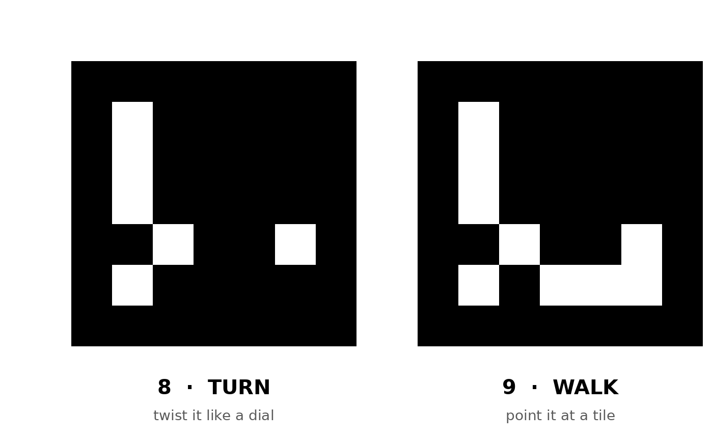

# Fun Games
Small browser games by Marie. All games: https://marie-6.github.io/fun-games/

## Off The Table
You are a cat. Knock things off the table without getting caught.

Play: https://marie-6.github.io/fun-games/off-the-table/

Controls: mouse, phone (scan the QR code), or your hands via webcam.

Presentation: https://marie-6.github.io/fun-games/off-the-table/presentation/ (arrow keys to move, N for speaker notes, F for full screen)

## Lantern Shadows
Spirits drift toward the lantern. Make their hand shadow before they reach the flame.

Play: https://marie-6.github.io/fun-games/lantern-shadows/

Controls: hand gestures via webcam, recognized by a Teachable Machine image model. There is also a keyboard demo (keys 1–6).

Links for teachable machines:https://teachablemachine.withgoogle.com/models/5wNvyhI--/

## Mothlight
You are the last lantern in the garden. Drink oil to stay lit and keep away from the moths.

Play: https://marie-6.github.io/fun-games/mothlight/

Controls: W A S D only. Double-tap any of them to dash.

## Pigeons in New York
You are a city pigeon. Cross New York's streets without getting squashed by taxis, buses or people.

Play: https://marie-6.github.io/fun-games/pigeons-in-new-york/

Controls: one button. Press Space to stop or walk, hold Space to fly. On a phone, tap the screen.

## Look Busy
You are an office worker. Sneak off to slack while the boss isn't looking. Three strikes and you're fired.

Play: https://marie-6.github.io/fun-games/look-busy/

Controls: W A S D only.

## Turnstone
A Monument Valley–style puzzle. Turn the bridge to make paths that only exist from this angle.

Play: https://marie-6.github.io/fun-games/turnstone/

Controls: two printed ArUco markers held up to the webcam. Marker 8 turns the bridge, marker 9 picks where to walk. Mouse and Q / E also work.

## Fortune Shrine
A paper fortune teller (cootie catcher) controller. Show the paper shrine door (marker 9) to open the shrine for 5 minutes, then open a flap of the fortune teller (markers 1–8) and hold it inside the circle. Each flap gives an animal, a lucky color and a thing to do today, with a sound and an animation.

Play: https://marie-6.github.io/fun-games/fortune-shrine/

Printable markers: https://marie-6.github.io/fun-games/fortune-shrine/markers.html

Video of the game being played: https://marie-6.github.io/fun-games/fortune-shrine/play-demo.mp4

Demo video of the paper tools (the 东南西北 fortune teller and the shrine door with marker 9): https://marie-6.github.io/fun-games/fortune-shrine/demo.mp4

Controls: printed ArUco markers held up to the webcam. Keyboard for testing: 9 opens or closes the shrine, 1–8 pick a fortune, 0 goes back, D shows the debug view.

Full guide with how to play, the marker codes and how the code works: [fortune-shrine/README.md](fortune-shrine/README.md)
