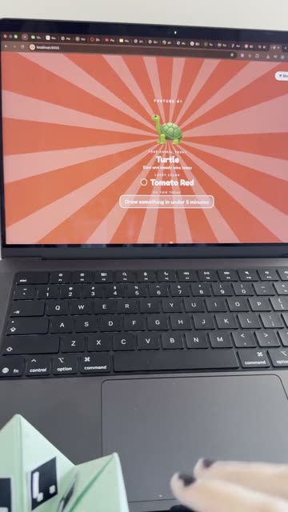
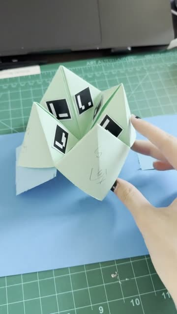
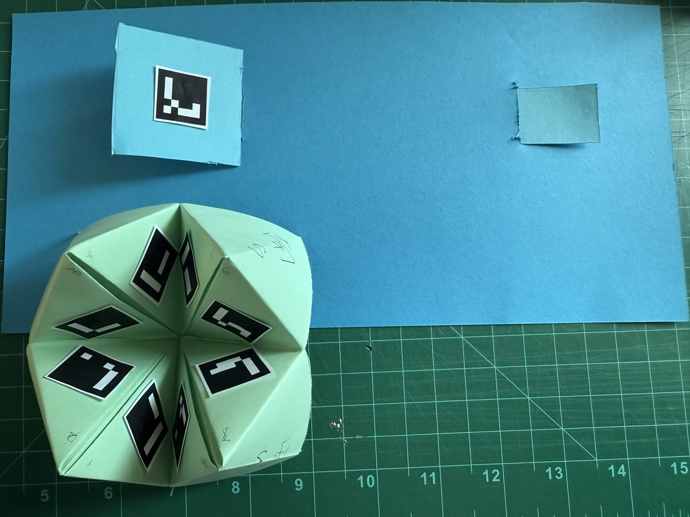
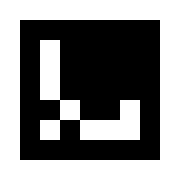
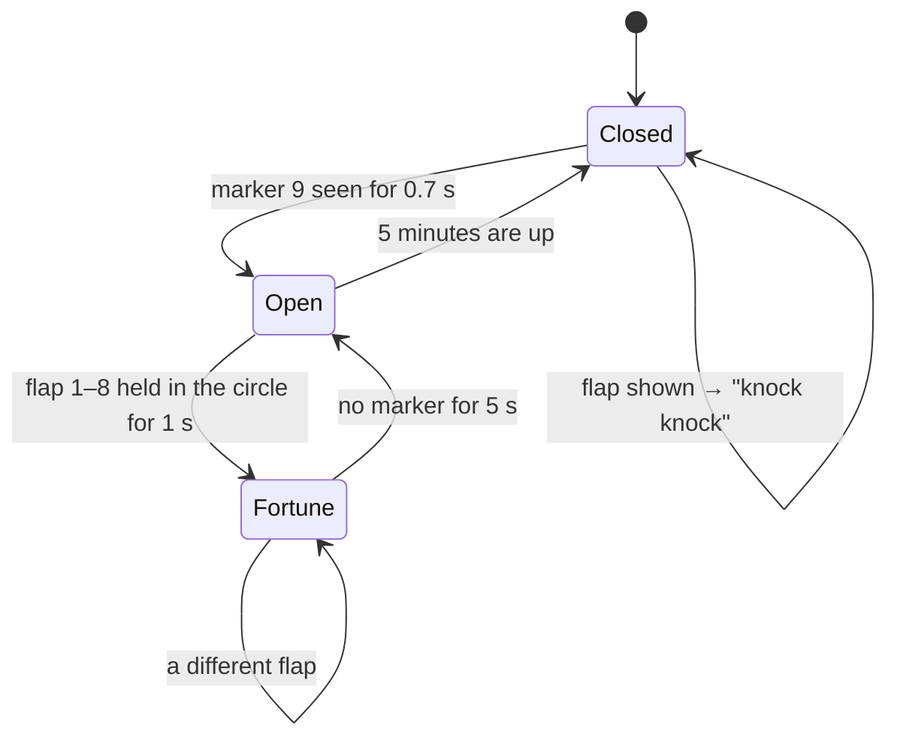

# ⛩️ Fortune Shrine

A **paper controller** for the browser. Fold a paper fortune teller (东南西北 / cootie catcher), stick a printed marker under each inner flap, and the webcam turns whichever flap you open into a fortune with sound and animation. A paper shrine door with its own marker opens the shrine first.

Everyone already knows how to use a fortune teller, so there is nothing new to learn. The paper is the interface.

**▶ Play:** https://marie-6.github.io/fun-games/fortune-shrine/

**🖨 Printable markers:** https://marie-6.github.io/fun-games/fortune-shrine/markers.html

**🎬 Watch how to play:** https://marie-6.github.io/fun-games/fortune-shrine/play-demo.mp4

**🎬 Demo of the paper tools:** https://marie-6.github.io/fun-games/fortune-shrine/demo.mp4

| How to play (75 s) | The paper tools (12 s) |
|---|---|
| <a href="https://marie-6.github.io/fun-games/fortune-shrine/play-demo.mp4"></a> | <a href="https://marie-6.github.io/fun-games/fortune-shrine/demo.mp4"></a> |
| Opening the shrine, playing the 东南西北, and getting a 🐢 Turtle and a 🐸 Frog fortune | The 东南西北 fortune teller and the shrine door with marker 9 |

---

## What you need



*The paper tools: the shrine door (blue, flipped open to show marker 9) and the 东南西北 fortune teller (green, markers 1–8 under the flaps).*


- A laptop or phone with a webcam, and Chrome, Safari or Firefox
- A printed marker sheet ([markers.html](https://marie-6.github.io/fun-games/fortune-shrine/markers.html), print at 100%)
- One square sheet of paper folded into a fortune teller, with markers **1–8** glued under the eight inner flaps
- A paper shrine door (a flap of card that flips open) with marker **9** under it

## How to play

1. Open the [play link](https://marie-6.github.io/fun-games/fortune-shrine/), press **Start ✦** and allow the camera.
2. **Open the shrine.** Flip the paper shrine door open so the camera sees marker 9. A ring fills around the peephole, the red and blue doors start to part, and then they slide open with a chime and confetti.
3. The shrine **stays open for 5 minutes**. A countdown sits in the top-right corner and turns red in the last 10 seconds. Showing marker 9 again restarts the 5 minutes.
4. **Play the fortune teller** the usual way: pick a color, spell it out, pick a number, count it out, then pick a final number and lift that flap.
5. **Hold the open flap inside the dashed circle** and keep it still for one second while the ring fills up.
6. **Your fortune appears.** The screen fills with your lucky color, an animal pops up, and you get a "do this today" task, with a chime and confetti.
7. Put the flap away. After 5 seconds with no marker the screen goes back to the circle, ready for the next person.

If you show a flap while the shrine is still closed, the doors shake and an animal says *"Knock knock! Open the shrine door first 🔑"*.

### Keyboard (for testing without paper)

| Key | Action |
|---|---|
| `9` or `Space` | Open / close the shrine doors |
| `1` – `8` | Show that flap's fortune |
| `0` or `Esc` | Back to the circle |
| `D` | Debug view: what the camera sees, with outlines around each marker |

## The marker codes

The markers are **Original ArUco** markers, the same kind used in the class tracking example. Each one is a 7×7 grid: a black border around 5×5 data cells. Each of the 5 rows is one of four fixed patterns, and the marker's ID picks which pattern goes in each row.

| ID | Marker | Where it goes | What it does |
|---|---|---|---|
| 1 |  | Fortune teller, inner flap 1 | Fortune #1 |
| 2 |  | Fortune teller, inner flap 2 | Fortune #2 |
| 3 |  | Fortune teller, inner flap 3 | Fortune #3 |
| 4 |  | Fortune teller, inner flap 4 | Fortune #4 |
| 5 |  | Fortune teller, inner flap 5 | Fortune #5 |
| 6 |  | Fortune teller, inner flap 6 | Fortune #6 |
| 7 |  | Fortune teller, inner flap 7 | Fortune #7 |
| 8 |  | Fortune teller, inner flap 8 | Fortune #8 |
| 9 |  | Paper shrine door | Opens the shrine for 5 minutes |

**Tips for the paper:** use matte paper, since glare hides the marker. Keep the white margin around each marker. Hold the flap 20–50 cm from the camera, and make sure only one flap's marker sits inside the circle.

## The two states



- **Closed:** red and blue doors with a camera peephole and a row of animals.
- **Open:** the live camera with a rainbow tint, a dashed circle to aim at, and the 5-minute countdown.
- **Fortune:** the whole screen turns the lucky color, with the animal, lucky color and task.

## How the code works

Everything is in one file, [`index.html`](index.html): HTML, CSS and JavaScript. Tracking uses [js-aruco](https://github.com/jcmellado/js-aruco) (`lib/cv.js` and `lib/aruco.js`, MIT license), the same library as the class example, saved locally so the game works without internet. All sounds are made with the Web Audio API, so there are no sound files.

### 1. Reading markers from the webcam

Every frame, the video is drawn onto a hidden 640-pixel-wide canvas and js-aruco finds every marker in it. Marker 9 counts anywhere in the frame. For flaps 1–8, only the marker **inside the circle** counts, and if there are several, the one closest to the center wins.

```js
const markers = detector.detect(cx.getImageData(0, 0, W, H));
for (const m of markers) {
  const mx = m.corners.reduce((a, c) => a + c.x, 0) / 4,   // center of the marker
        my = m.corners.reduce((a, c) => a + c.y, 0) / 4,
        d  = Math.hypot(mx - W/2, my - H/2);                // distance from the circle's center
  if (m.id === 9) key = true;
  else if (m.id >= 1 && m.id <= 8) { stray = true; if (d < radius && d < bestD) { flap = m.id; bestD = d; } }
}
```

### 2. Opening the shrine for 5 minutes (marker 9)

Marker 9 has to stay visible for 0.7 s. While it does, the ring fills and the doors open a little (`setCrack`), so the screen follows your hand. Once the ring is full, the doors open and a 5-minute timer starts.

```js
const OPEN_MS = 5*60*1000;          // how long the shrine stays open

if (!doorOpen) {
  const keyP = keyOn ? Math.min((now - keySince) / KEY_HOLD_MS, 1) : 0;
  setRing($("keyRing"), keyP); setCrack(keyP);       // doors start to part as the ring fills
  if (keyP >= 1) setDoor(true);
} else {
  if (keyAppeared) { openUntil = now + OPEN_MS; updateTimer(); }   // shown again -> another 5 minutes
}
```

`updateTimer()` runs 4 times a second, shows the `m:ss` countdown and closes the doors when time runs out.

### 3. Hold to reveal (flaps 1–8)

A fortune only appears after the same flap stays in the circle for one full second (`HOLD_MS`). The ring fills and ticks up in pitch while you hold. Short blinks where the camera loses the marker for under 0.3 s (`GRACE_MS`) are ignored, so a shaky hand doesn't reset it.

```js
if (cand && cand !== shown) {
  const p = (now - candSince) / HOLD_MS; setRing($("ring"), p);
  if (now - lastTick > 120) { SFX.tick(p); lastTick = now; }
  if (p >= 1) { reveal(cand); setRing($("ring"), 0); }
}
```

### 4. The fortunes

Each fortune combines three lists: `COLORS`, `ANIMALS` and `TODOS`. The lists are shuffled with **today's date as the random seed**, so a flap gives the same fortune all day and a new one tomorrow.

```js
const today = new Date().toDateString();
const R = rng(hashStr(today));
const C = shuffled(COLORS, R), A = shuffled(ANIMALS, R), T = shuffled(TODOS, R);
const fortuneFor = n => ({ n, color: C[n-1], animal: A[n-1], todo: T[n-1] });
```

`reveal(n)` fills in the card, sets the `--lucky` color for the full-screen flood, picks dark or white text depending on how light the color is, plays a chime and drops confetti.

### 5. States in CSS

The JavaScript only adds or removes classes on `<body>`, and CSS does the animation:

| Class | Meaning | What changes |
|---|---|---|
| `open` | Shrine is open | Doors slide off screen, the sign lifts, the countdown appears |
| `revealed` | A fortune is showing | Color flood, sunburst, animal pop-in, rows rise in one by one |
| `doors-shake` | Flap shown to a closed shrine | Doors rattle |
| `debug` | `D` pressed | Shows the camera canvas with marker outlines |

## Things you can change

All of these are near the top of the `<script>` in `index.html`:

| Setting | Default | What it does |
|---|---|---|
| `OPEN_MS` | `5*60*1000` | How long the shrine stays open (5 minutes) |
| `KEY_HOLD_MS` | `700` | How long marker 9 must be seen to open the doors |
| `HOLD_MS` | `1000` | How long a flap must be held in the circle |
| `IDLE_MS` | `5000` | How long with no marker before going back to the circle |
| `FINDER` | `0.48` | Size of the circle (fraction of the screen) |
| `COLORS`, `ANIMALS`, `TODOS` | | The fortune content |

## Files

```
fortune-shrine/
├── index.html        the game
├── markers.html      printable marker sheet (IDs 1–9)
├── markers/          marker images used in this README
├── play-demo.mp4     video of the game being played
├── play-demo-poster.jpg
├── demo.mp4          video of the paper tools
├── demo-poster.jpg   video thumbnail
├── tools.jpg         photo of the paper tools
└── lib/
    ├── cv.js         js-aruco computer vision helpers
    └── aruco.js      js-aruco marker detector
```

## Run it on your own computer

The camera only works on `https://` or `localhost`, so serve the folder instead of double-clicking the file:

```sh
cd fortune-shrine
python3 -m http.server 8000
# then open http://localhost:8000
```

## Credits

- Made for *Histories of Interaction* at SVA as a "Paper Controller" assignment, building on the class ArUco tracking example.
- Marker tracking: [js-aruco](https://github.com/jcmellado/js-aruco) by Juan Mellado (MIT).
- Font: [Fredoka](https://fonts.google.com/specimen/Fredoka) from Google Fonts.
