# Process record: Pigeons in New York

Route A: Remix, one decision deeper. I took my one-button game and kept improving it by playing it.
Made with an AI assistant (Claude). [▶ Play](https://marie-6.github.io/hello-world/week7-8/) · [All prompts](PROMPTS.md) · [Probe](probes/traffic-overlap.html)

## What did I want to make stronger?

The game: a pigeon crossing New York streets, like *Crossy Road*, with only one button.

I wanted to make it **fair and easy to start**:

- **Fair:** when I lose, it should be my mistake, not the game's. The first version had no gap to cross, cars on top of each other, too many people and an Easy mode that was too hard.
- **Easy to start:** a new player should know the rules and choose when to begin. At first there were no rules, no modes, and I couldn't tell when the pigeon would walk again.

## Which choices did I make?

**Start page**

- At first there was no start page and no modes. I added a start page where you can pick a mode and learn the rules.
- The rules on it are short and simple: the goal, the 2 controls and 3 tips.
- Picking a mode doesn't start the game. You press Start, so people can still change their mind.

**Controls**

- Press Space to stop, press again to walk. Before, a tap stopped it for a hidden time, and I never knew when it would walk again.
- Hold Space to fly. Flying uses a Wings bar, so you can't fly forever.
- All the words say "Space" instead of "tap".

**The pigeon**

- It moves its neck like a real pigeon: the head stays still, then jerks forward.
- 3 lives in every mode, for more time playing.
- Pizza gives you a life back, but each life costs more pizza, so you can't live forever.
- When hit, it stops for a moment, then blinks and gets dizzy stars. Every death looks the same: flattened.

**Difficulty**

- I added 3 modes: Easy, Medium, Hard. Easy was still too hard, so I made it much easier.
- Car speed and number of cars change by mode. Buses only appear in Medium and Hard.
- Fewer people on the sidewalk, so cars are the main danger.

**Fair streets**

- Every gap between cars is big enough to walk through. Wide streets have a safe island.
- Cars don't overlap: each new car checks every car in its lane.
- Cars don't run in parallel: each lane has its own speed.
- Fountains, pizza and people don't cover each other.

**Maps**

- 12 New York neighborhoods, including Washington Square Park. None repeats in one game.

## What did I keep on purpose?

- One button. Enter, ↑ and the mouse also work, but you only need Space.
- No way to win, only to lose. The streets go on forever, and you try to beat your best score.
- The dizzy and shining effect when hit.

## What did I leave out?

- A big hit effect (spinning, X eyes, screen shaking, red flash). I tried it and didn't like it, so I went back to a short stop.
- Different lives per mode (5 / 3 / 1). The AI suggested it. I chose 3 for every mode.

## Why it looks and feels this way

- The head-jerk walk makes a dangerous street feel funny instead of scary.
- Real neighborhoods like Washington Square Park make it feel like New York, not just roads.
- When the pigeon only blinked, it was hard to notice it got hit. A short stop makes it clear, without the big effect that felt like too much.
- The pizza on the street is not made up. I took this photo in New York: pizza slices lying in the road, right next to a bus and a taxi. That's exactly the pigeon's world in the game.

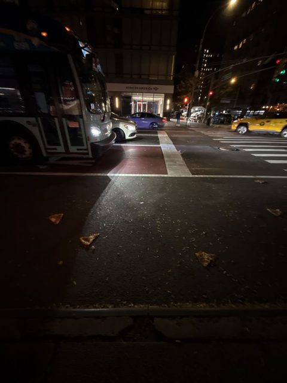

## What didn't work the first time

| Problem | First try | Then |
|---|---|---|
| Too many people | Fewer new people | Still piled up, because there was no limit. A fixed number per sidewalk worked. |
| Easy too hard | A bit slower | Not enough. Half speed and no buses worked. |
| Cars still overlapping | Fix was done | My screenshot was the old page. A refresh showed the fix. |
| Being hit | Big spinning effect | Didn't like it. A short stop worked. |

### Before and after

Before screenshots are from when I found each problem. After screenshots are from the current game.

**Start page.** Before, the rules were long and there was no Start button. Now: the goal, 2 controls, 3 tips and a Start button.

| Before | After |
|---|---|
| 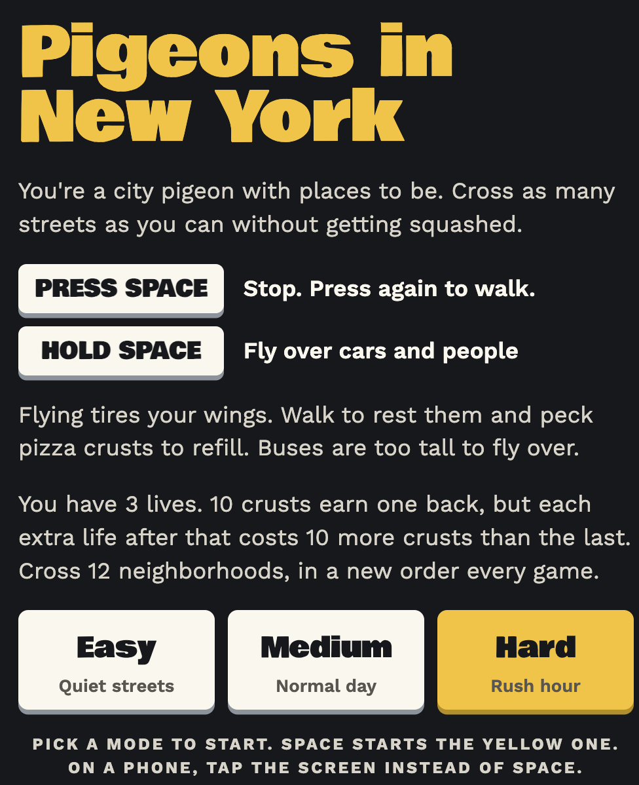 | 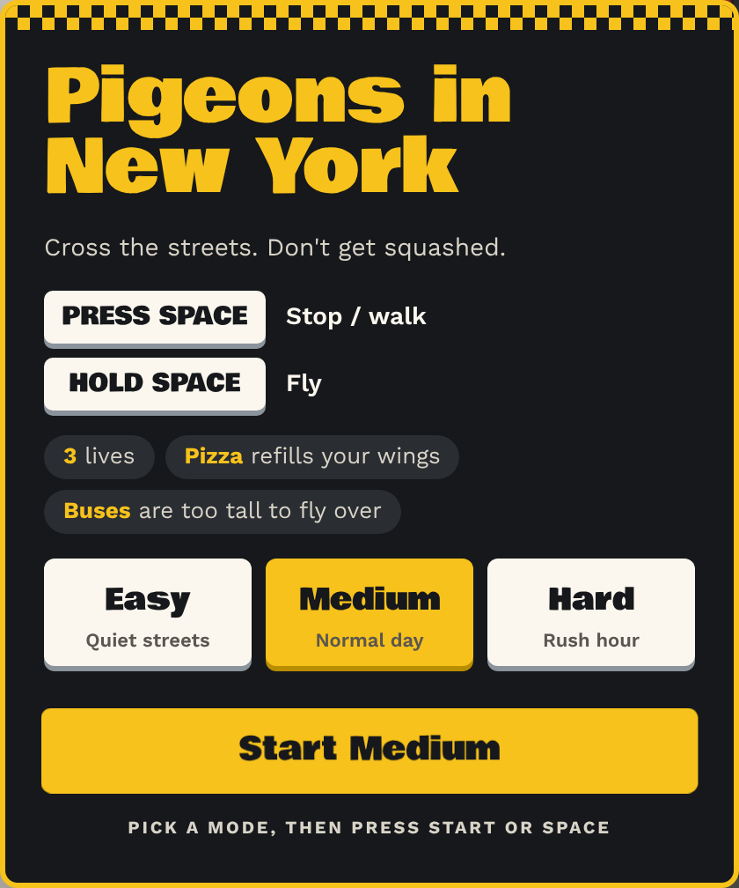 |

**Cars.** Before, cars drove on top of each other. Now each new car checks every car in its lane, and each lane has its own speed.

| Before | After |
|---|---|
| 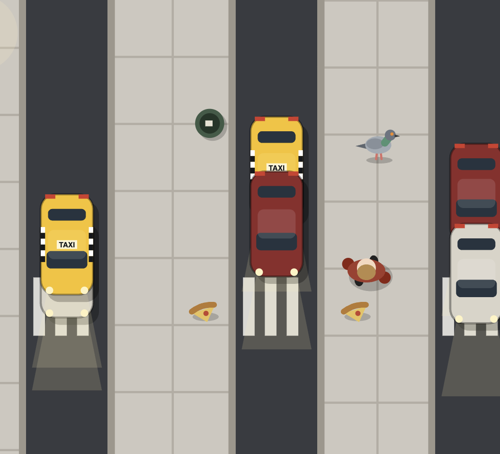 | 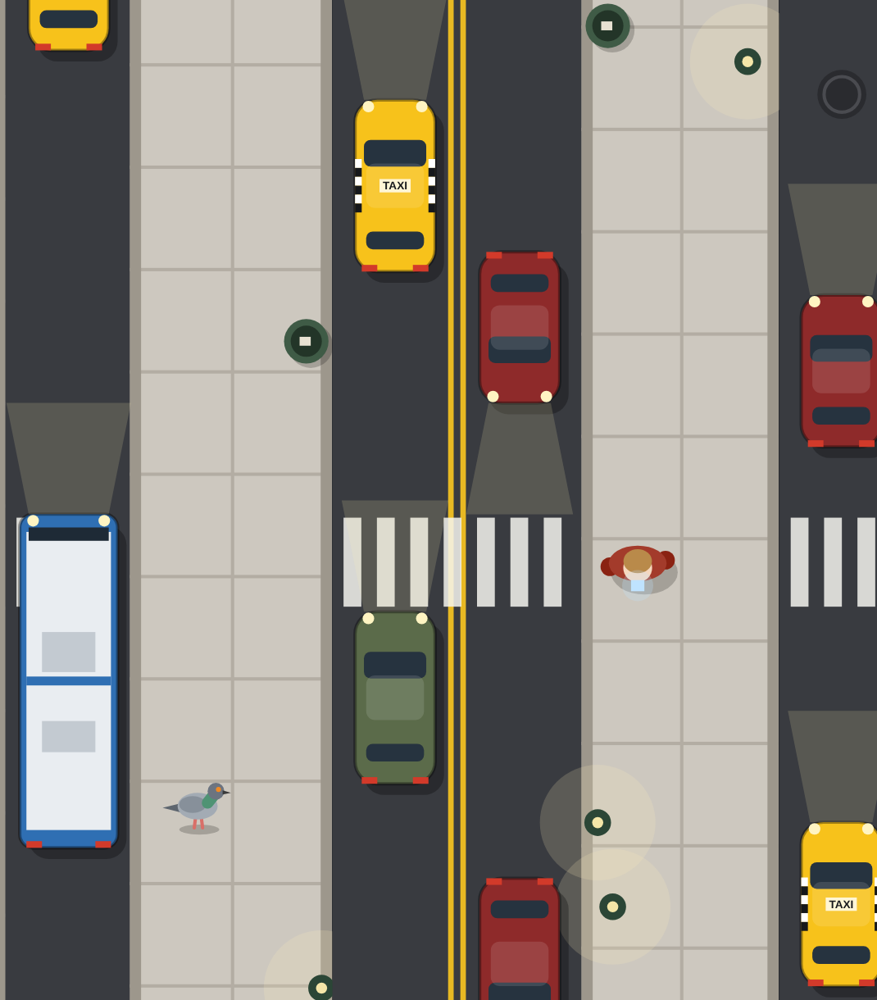 |

**Car speed.** Before, each lane picked a random speed between 85 and 135, so neighbouring lanes were often almost the same and cars drove side by side. Now the lanes on one street get 4 fixed paces (0.7×, 0.87×, 1.03×, 1.2×) in a shuffled order, so any 2 lanes differ by at least 15%.

The number on each lane is its speed. The pink line is where each car was in the last second: a longer line means a faster car. Before: 122 / 122 and 112 / 117. After: 161 / 94 and 99 / 115. Both clips are Medium mode with the pigeon standing still. Before is the version from just before this change ([commit 8a4995a](https://github.com/Marie-6/hello-world/tree/8a4995a/week7)), after is the current game. The numbers and lines were added only for these clips, not to the game.

| Before | After |
|---|---|
| 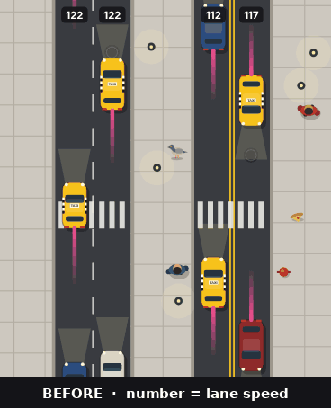 | 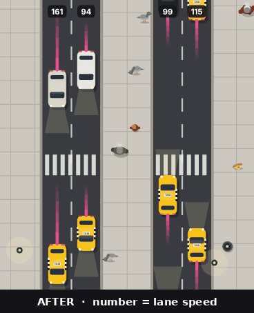 |

**Fountains.** Before, two fountains covered each other. Now decorations only go where there's space.

| Before | After |
|---|---|
| 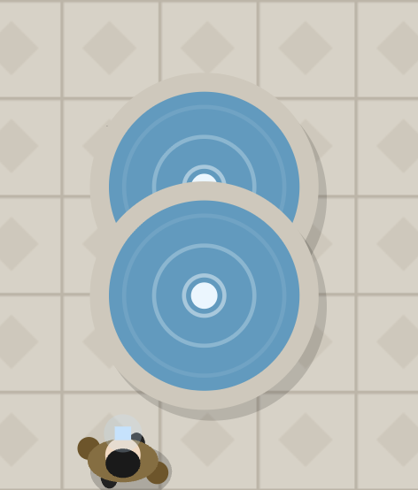 | 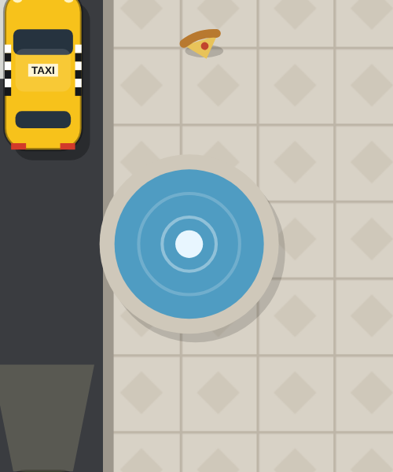 |

**Deaths.** Before, a bus made the pigeon lie on its back, but a car made it flat. Now every death is flat.

| Before (bus) | After (every death) |
|---|---|
| 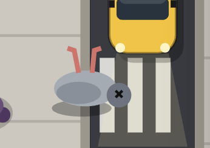 | 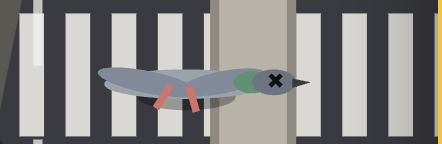 |

## Evidence (before / after)

Starting version: the first build on Oct 28 (prompt 7 in [PROMPTS.md](PROMPTS.md)). See the [commit history](https://github.com/Marie-6/hello-world/commits/main/week7).

The [probe](probes/traffic-overlap.html) tests 2,000 random lanes:

- Old rule: about 110,000–130,000 frames with overlapping cars.
- New rule: 0.

What this shows: the new rule stops cars from overlapping.
What it doesn't show: how the game feels to play. The other choices I checked by playing it myself, not with other players.

## A prompt and the AI's first answer

> **Me:** "maybe we can create a game called "pigeons in newyork", which is a game similar to the crossing road game. but only press one button for the pigeon to stop and hold the button for pigeon to fly. and pigeons should avoid people and cars."
>
> **AI:** "Tap: the pigeon stops in place. Hold: the pigeon flies… No input: the pigeon keeps walking forward on its own… Flying uses a stamina bar that refills while you walk. Otherwise you could just fly the whole time."

I kept the Wings bar from this answer. Later I changed "tap to stop" to "press to stop, press again to walk".

## How I write prompts

- Add a screenshot and say what looks wrong.
- Say what to keep, like "keep the dizzy and shining part".
- Say "just check, don't change" when I only want a check.

## Who did what

- **Me:** the idea and every choice above. I found the problems by playing.
- **AI (Claude):** wrote the code, explained why the bugs happened, and tested the fixes.
- **Inspired by:** *Crossy Road*, *Flappy Bird*. No code or images were copied.

## Next step

When a person on the sidewalk is blocked, they turn around. Does that feel fair, or does it feel like a trap for the pigeon?

## Class proposal

When AI changes something, say how it was checked: played, tested with code, or not checked. The AI often said "I haven't played it", and once a change didn't fix the problem.
