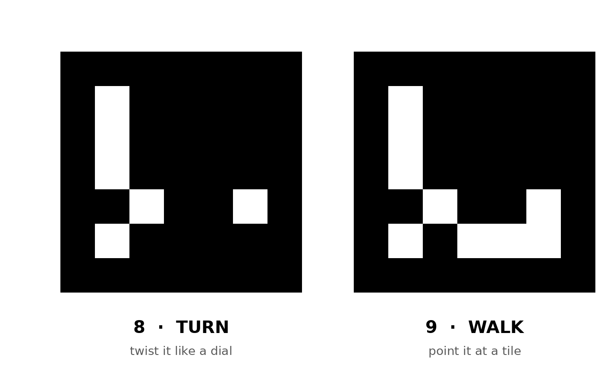

# Turnstone 🏛️

A small Monument Valley–style puzzle. Guide the red-cloaked traveller across floating stone towers. Turn the teal bridge to make paths that only exist from this angle: if two tiles *look* connected, they are.

**Play:** https://marie-6.github.io/fun-games/turnstone/

## The two codes
You play with two printed ArUco markers. Print them (or show them on your phone) and hold them up to your webcam.

| Marker | What it does |
|---|---|
|  **8 · Turn** | Twist it like a dial. The bridge turns with it and clicks into place at every quarter turn. |
|  **9 · Walk** | Move it to steer a cursor. Hold it still over a tile for about ¾ second and the traveller walks there. |

Single files: [marker-8.png](markers/marker-8.png) · [marker-9.png](markers/marker-9.png). Leave the white border around each marker when you print or cut it out.

## Playing without markers
| Input | Action |
|---|---|
| Click a tile | Walk there |
| Drag the dial on the bridge, or Q / E | Turn |
| F | Flip the turn direction (if twisting 8 turns the wrong way) |
| R | Restart the level |

## Levels
1. **The Bridge**: swing the bridge into place and cross.
2. **The Ride**: stand on the bridge and turn it while you ride.
3. **The Long Way**: the bridge locks while you stand on it, so go around and turn it behind you.

## Notes
- Click **Start camera** and allow camera access. The camera needs the page opened over https (GitHub Pages works) or as a local file.
- Marker detection runs in the browser with [js-aruco](https://github.com/jcmellado/js-aruco) (MIT), inlined into the page. Nothing leaves your computer.

## Files
- `index.html`: the whole game in one file
- `markers/`: the two markers, plus a printable sheet with both
